# Chronocounter

A computer-vision based app and server setup for automatically counting measure numbers.
# Project Context

Sheet music is made up of measures that are separated by measure bars, repeat bars, and double bars. Some measures contain long multi-measure rests as well. Musician use measure numbers to rehearse (e.g., everybody start at measure 179).

<figure> 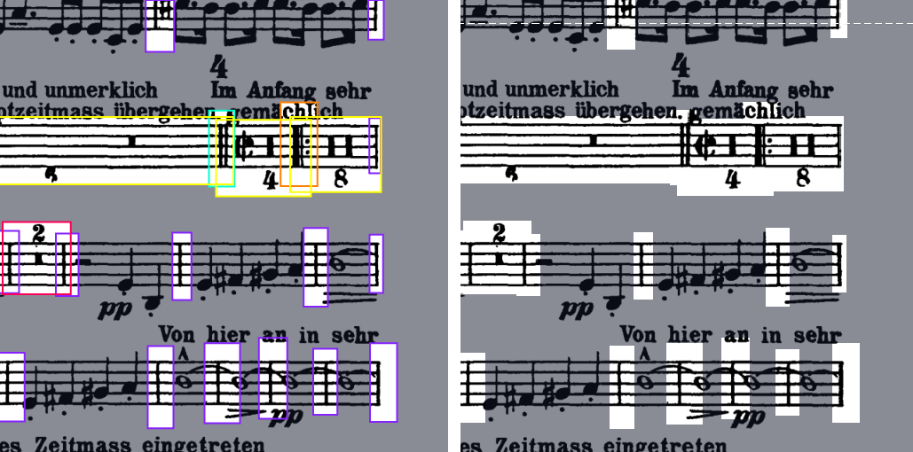 <figcaption>On the left is an annotated image of sheet music and on the right is the same image with boxes hidden. 
Measure bars have purple boxes, double bars have cyan boxes, repeat bars have orange boxes, long rests with the rest duration on the bottom have yellow boxes, and long rests with the rest duration on top have red boxes. </figcaption> </figure>

I often have to count measure numbers for my Seattle Youth Symphony Orchestra music because we use scans of old music that don't have measure numbers written in. I wanted an easier way to count measure numbers and I was inspired by my computer vision work in a research internship to train an object detection model to detect measure bars, repeat bars, double bars, and long rests to quickly count measures.

# What I Built

I trained several computer vision models through Roboflow and created an app where you can photograph music and send the images to a server for processing and automatic measure-number counting. Here is a flowchart explaining the system:

<figure> 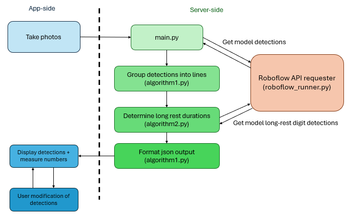 <figcaption>Chronocounter app and server flowchart.</figcaption> </figure>

# Repository Setup

reference/ contains various reference materials from the build process:
- reference/ai/ contains build prompts for creating the mobile app and a sample Codex chatlog
- reference/images/ contains various images of model outputs and flowcharts
- reference/godot/ contains the AI-built Godot project

scripts/ contains various scripts I used during the project:
- scripts/pipeline/ contains the server-side code, conda environment .yml file, and test examples 
- scripts/tools/ contains scripts I used in the annotation process, sorted by usage in the main model or long rest OCR training
# Build Process
## Summary
I annotated datasets with CVAT before downloading and slicing with a custom script made with AI. I uploaded the sliced datasets to Roboflow where I checked the annotations before augmenting the dataset, usually with Roboflow's Blur (10pxl, 10 degrees) and Rotate (10 degrees), and training a model.

<figure> 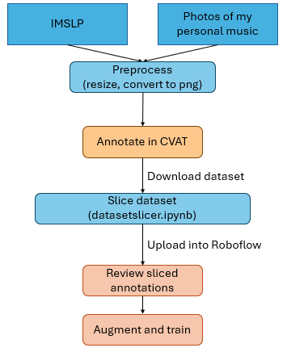 <figcaption>Flowchart detailing my annotation process.</figcaption> </figure>

I also made datasets for training an OCR long-rest duration detection model, which you can find more information about in Issue #2 of the Challenges section.

I designed a server-side pipeline that interfaces with Roboflow to run inference on an input image, group staff lines, run predictions on long rests, and format outputs (either for transferring to the mobile app or as local images for viewing through test.py). I used AI tools to create the server-side pipeline with minor human intervention for debugging or fine-tuning parameters.

I used AI tools to build the app. I first used Claude to generate a series of build prompts which I revised with Claude and entered into Codex to build the Godot project. I would export the project to my Pixel 6a every 1-3 prompts to verify the app worked, often prompting Codex to make additional changes based on issues I noticed. You can find the build prompts and a sample chatlog in reference/ai/. [Click here for the version-controlled app build repo](https://github.com/bbrb546/chronocounter_app) (pretty much everything there is AI-made).

## AI Usage

All code in this project was created with the help of assistive tools including Claude, ChatGPT, Pi agent harness, and Codex. I primarily supplied the ideas and design vision, annotated and formatted datasets, and debugged and experimented to build the project.

## Model Improvement

Here are some graphics illustrating how model inferences improved with different datasets:

Primary detection model performance on photographed music not in training dataset, using provided pipeline.
<figure> 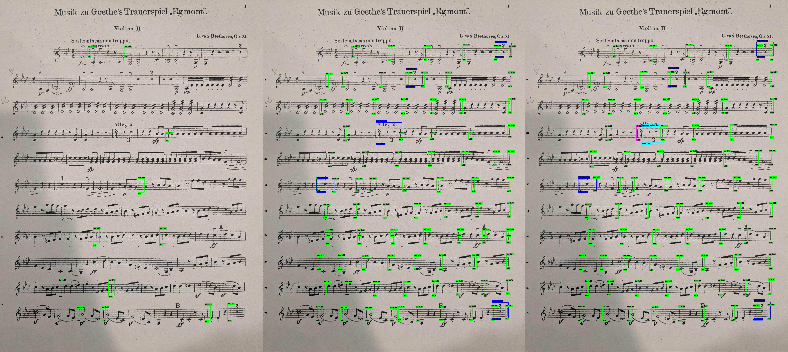 <figcaption>Left to right: models trained on <a href="https://universe.roboflow.com/test-workspace-yhesc/dataset-v0-2c">dataset v0.2c</a> (500 images), <a href="https://universe.roboflow.com/test-workspace-yhesc/dataset-v0-3">dataset v0.3</a> (949 images), and <a href="https://universe.roboflow.com/test-workspace-yhesc/dataset-v1-0">dataset v1.0</a> (1.25k images), confidence threshold = 0.6. All ran with the fdataset v0.2a OCR model (confidence threshold = 0.6). Note how dataset v1.0's model correctly detected the double bar and long rest bottom in the 4th line from the top compared to dataset v0.3.</figcaption> </figure>

Digit detection model performance on a sheet music scan from IMSLP between EasyOCR and a custom model (fdataset v0.2a, confidence threshold = 0.6). They are augmented with the focus crop step (check Build Process -> Challenges -> Issue #2). No prediction defaults to -1.

<figure> 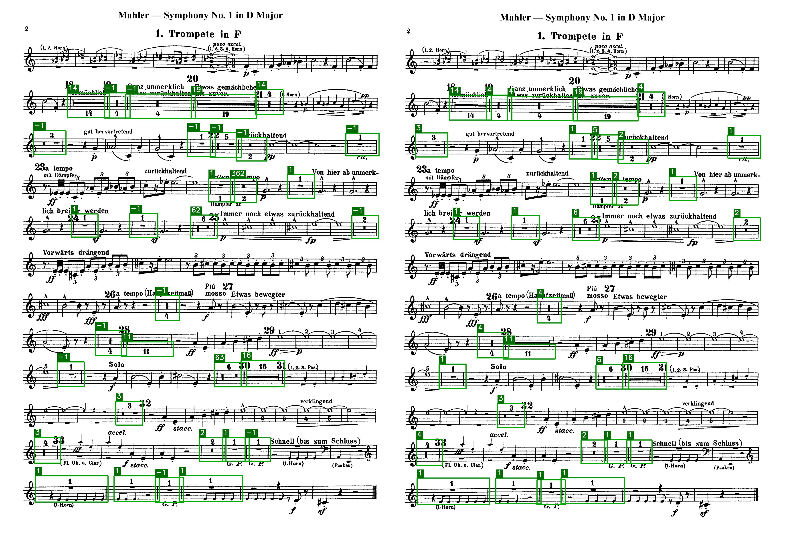 <figcaption>My custom model is way more accurate!</figcaption> </figure>

## Challenges

I will outline 3 big challenges I faced during this project and how I solved them.
### Issue #1: images are big!

Music images are high-res! Converting IMSLP pdfs into pngs gives ~1600x2400 images and my phone takes 4032x3024 photos (which I resized to half the resolution with online tools) which are way too big to train an object detection model with. So, after annotating the initial dataset and doing some research, I learned about Slicing Aided Hyper Inference (SAHI) which is a way of chopping up big images, running inference, and then stitching it all together. I decided I'd use this for inference, and trained a model accordingly.

So, I created a script to slice up my dataset into overlapping 640x640 chunks that I could train a model on. Initially, the script only removed bounding boxes if they were below a certain fixed size threshold. This led to impossible-to-predict bounding boxes like these:

<figure> 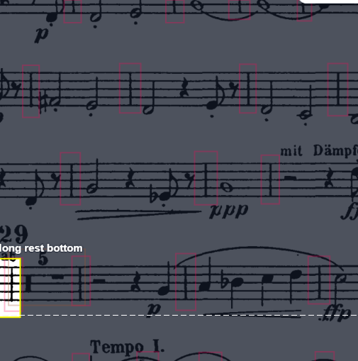 <figcaption>Screenshot from Roboflow of <a href="https://universe.roboflow.com/test-workspace-yhesc/dataset-v1-0-sliced-nocrop/images/4cfXQjde88GG6SwffF7p?queryText=class%3A%22long+rest+bottom%22&amp;pageSize=100&amp;startingIndex=0&amp;browseQuery=true">a sliced 640x640 image</a> with an undetectable "long rest bottom" annotation. I wouldn't have known there was a long rest here if not for the box</figcaption> </figure>

So, I explored various thresholds before settling on a threshold of if more than 50% of a box was contained in the cropped image, it would remain with a special rule for long rests (which either needed >50% of the bounding box included in the sliced image OR >50% of the middle third, which usually contains the most important part of the rest - the long rest duration).

This resulted in sliced images like these:

<figure> 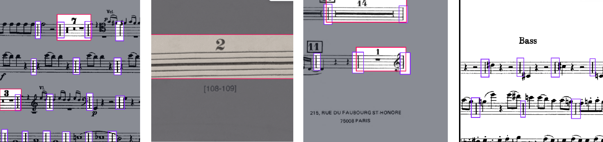 <figcaption>Screenshots from Roboflow. Left to right: <a href="https://universe.roboflow.com/test-workspace-yhesc/dataset-v1-0/images/Idlb3uyDR6gC1fW12kjR?queryText=&amp;pageSize=100&amp;startingIndex=0&amp;browseQuery=true">an example of partially cut-off measure bars along the bottom that were kept</a>, <a href="https://universe.roboflow.com/test-workspace-yhesc/dataset-v1-0/images/0beolGsrZTB99XfgISXY?queryText=-class%3Abar+-class%3A%22double+bar%22+-class%3A%22end+bar%22+-class%3Aending+-class%3A%22long+rest+bottom%22+-class%3A%22repeat+bar%22+scanned&amp;pageSize=100&amp;startingIndex=0&amp;browseQuery=true">an example of a sliced image fully containing the middle third of a long rest</a>, <a href="https://universe.roboflow.com/test-workspace-yhesc/dataset-v1-0/images/KmPuy6S2TSyy67GTMWRS?queryText=&amp;pageSize=100&amp;startingIndex=0&amp;browseQuery=true">an example of a cut-off long rest</a>, <a href="https://universe.roboflow.com/test-workspace-yhesc/dataset-v1-0/images/SRi5vb7QVRmFq69qYrK9?queryText=&amp;pageSize=100&amp;startingIndex=0&amp;browseQuery=true">an example of partially cut-off measure bars along the bottom that were dropped</a>.</figcaption> </figure>

The script is provided at scripts/tools/main_training_tools/datasetslicer.ipynb. I used a Colab notebook to run the dataset slicing script.

### Issue #2: long rest counting

This is a big one.

I initially planned to have users manually enter the duration of each long rest, but after some research I wanted to test out using the Python EasyOCR library for automatic numbering. This led me down a rabbit hole of trying to get it to work with the rest of the pipeline, building a solid framework that I could insert any OCR model into.

EasyOCR didn't do very well, sometimes due to extraneous noise:

<figure> 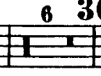 <figcaption>EasyOCR predicted 63 here due to the nearby rehearsal number 30.</figcaption> </figure>

So, I designed a focus crop preprocessing step that helped the OCR model receive a focused image ideally containing only the long rest duration. I first reannotated all long rest detections into two classes ("long rest" and "long rest bottom") depending on the positioning of the long rest length. The focus crop step then cropped out either the bottom half or top half of the long rest (preserving the half with the duration) and then only keeping the middle 3/5 of the image. This fixed some predictions but not all:

<figure> 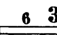 <figcaption>Even when focus cropped, EasyOCR still predicted 63. </figcaption> </figure>

I tried to crop more off the edges (e.g., only keeping the middle third) but sometimes that would remove the long rest duration for a bad long rest detection. So, I decided to train my own model.

Using my existing dataset as a baseline, I created scripts that made a new dataset consisting of cropped-out long rest bounding boxes that I uploaded to Roboflow (dataset v0.1a, 0.2a) to have digits be automatically annotated. I still had to manually go through the entire dataset to delete incorrect detections and tighten up bounding boxes in Roboflow. Then, I ran the dataset through another script that performed the cropping preprocessing step to create a final dataset (fdataset v0.1a, 0.2a) that I trained a model on.

<figure> 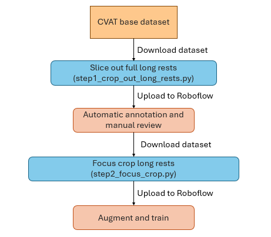 <figcaption>Flowchart visualizing my workflow for long rest processing.</figcaption> </figure>

Both scripts can be found in scripts/tools/ocr_training_tools/

This led to the current long rest processing system, which now knows that image is a 6.

<figure> 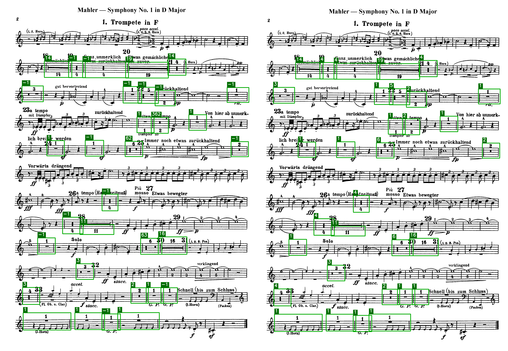 <figcaption>EasyOCR (left) and fdataset v0.2a (right). Both receive focus-cropped long rests detected with dataset v1.0 model. Check the 4th line from the bottom for the long rest I used for the sample images.</figcaption> </figure>

I put all long-rest processing functions in algorithm2.py which you can find in scripts/pipeline

### Issue #3: line grouping

A big processing step is to turn an object detection model's disparate detections into an ordered array of detections grouped by staff lines.

I initially just grouped detections whose centers were within a certain fixed pixel range, which probably wouldn't generalize well to different resolutions and didn't work well for slanted lines:

<figure> 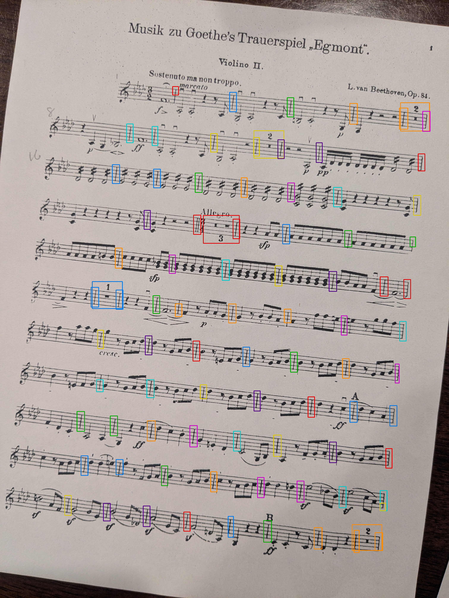 <figcaption>Color-coded output of algorithm1.py proximity-based line grouping mechanism. Each color corresponds to a line</figcaption> </figure>

So, I envisioned a line-grouping algorithm that picks two bounding boxes with similar y-values and draws a line through their centers. All bounding boxes that intersected this line would be grouped together. After proposing this idea to an AI system, it suggested to use a more complicated algorithm using RANSAC to find the line of best fit. I used AI to implement both, and my idea (augmented with candidate pools and multiple line options) turned out to be more effective:

<figure> 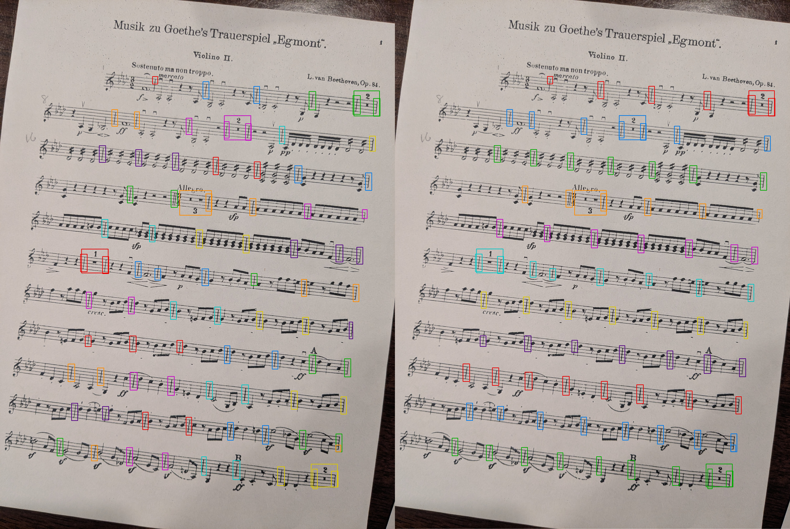 <figcaption>On the left is the AI's RANSAC idea and the right is my idea. The RANSAC was better than proximity-based grouping but not by much.</figcaption> </figure>

I put the line-grouping functions can be found in algorithm1.py in scripts/pipeline

# Datasets

You can find my Roboflow project containing all datasets here: <a href="https://universe.roboflow.com/test-workspace-yhesc">https://universe.roboflow.com/test-workspace-yhesc</a>

- dataset v1.0, v0.2, v0.2c, and v0.3 are the sliced datasets I trained the primary model on. I used CVAT for annotating unsliced images which I do not believe I can share.
- dataset v1.0 sliced nocrop is a sliced dataset without the cropped bounding box limitations (see Build Process -> Challenges -> Issue #1)
- fdataset v0.1a and fdataset v0.2a are datasets I used to train the long rest digit detection model on
    - dataset v0.1a and dataset v0.2a are non-focus cropped datasets that were an intermediate step towards the fdataset v0.Xa series (see Build Process -> Challenges -> Issue #2)